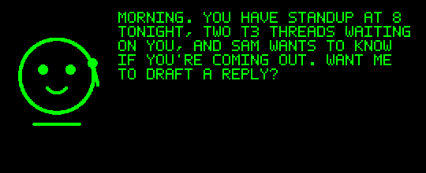
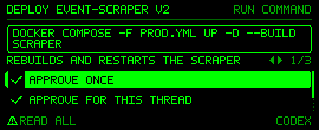
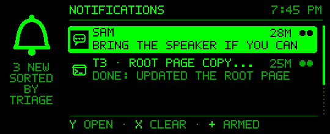

# RayNeo iO HUD

An open-source companion for the **RayNeo iO** smart glasses. An Android app turns the glasses into a heads-up display for your messages, your coding agents and your AI assistant, and an **8BitDo Micro** in your pocket drives it. A small self-hosted gateway connects it to the services you use.

It is built around three integrations that feel native on the lens:

- **[Hermes](https://github.com/NousResearch/hermes-agent)**, your assistant: talk to it by holding a button, read its replies, call it for a live voice conversation, and let it control the glasses through MCP tools.
- **[Beeper](https://www.beeper.com)**, every chat network in one inbox: read, reply by voice, react, find a chat by saying a name.
- **[T3 Code](https://github.com/pingdotgg/t3code)**, your coding agents: see which threads need you, answer their questions, approve commands, queue or steer, start new threads, on every machine.

<p>
  
  
  
</p>

The screens above are the app's own rendering tests: the 540 × 220 green display, pixel for pixel. Try every screen and the controller in your browser with the [simulator](simulator/README.md) (open `simulator/index.html` through any local web server).

## Hardware

| | |
| --- | --- |
| Glasses | RayNeo iO (monochrome green waveguide display, microphones, no camera). Stock firmware works; the app never flashes firmware. |
| Phone | Android 10 or newer. Android only: the phone is the brain, it renders every screen and pushes it to the glasses over Bluetooth. |
| Controller | 8BitDo Micro in keyboard mode, paired with the phone. |
| Audio | Headphones paired with the phone (the glasses have no speakers). |
| Server (for live data) | Anything that runs Node 24 or Docker and is reachable over HTTPS: a home server, a VPS, a Raspberry Pi. |

## Quickstart (about 10 minutes)

**1. Build and install the app** (JDK 17 and the Android SDK):

```sh
export JAVA_HOME=/path/to/jdk-17 ANDROID_HOME=/path/to/android-sdk
echo "sdk.dir=$ANDROID_HOME" > android/local.properties
./android/gradlew -p android assembleDebug
adb install -r android/app/build/outputs/apk/debug/app-debug.apk
```

The app opens in demo mode with synthetic data. Grant accessibility and notification access when asked, pair the 8BitDo Micro with the phone in keyboard mode, and pair the glasses from the app. Details: [docs/setup.md](docs/setup.md).

**2. Start the gateway:**

```sh
cd server/gateway
export GLASSES_API_TOKEN=$(openssl rand -hex 32) GLASSES_AGENT_TOKEN=$(openssl rand -hex 32)
export LLM_API_KEY=sk-...          # any OpenAI-compatible endpoint; set LLM_BASE_URL for others
export HERMES_URL=http://localhost:8642 HERMES_API_SERVER_KEY=...
export BEEPER_URL=http://localhost:23373 BEEPER_ACCESS_TOKEN=...
GATEWAY_WORKER=1 GATEWAY_OWNER_NAME="Sam" node server.mjs
```

Or use Docker: `server/gateway/docker-compose.example.yml`. Put it behind HTTPS ([docs/gateway.md](docs/gateway.md)).

**3. Connect the phone:** Settings → Gateway address `https://<your gateway>/glasses/v1`, Access token = `GLASSES_API_TOKEN`, Test, Save, turn on Live data, then **Load from gateway** to pick up your names, integrations and notification policy.

## Features

| Area | What you get | Needs |
| --- | --- | --- |
| **Assistant** (core) | Hold-to-talk chat with streamed replies and an animated avatar, quiet mode, live voice calls, replies that land in Notifications if you walk away, an MCP server so the assistant can open apps, press buttons, push documents and reminders. | Hermes |
| **Beeper** (core) | Priority inbox, threads, voice replies with @mentions, reactions, glasses-only pins, spam folding, find a chat by name, assistant approvals by reaction. | Beeper Desktop API |
| **T3 Code** (core) | Needs-you / done / working lists, agent questions and approvals, queue or steer, history, usage limits, new threads by voice, notifications for watched threads. | T3 Code on your machines |
| Notifications | Every phone notification is routed to pop up, list or stay on the phone by a JSON policy plus an optional model classifier. Beeper, T3 Code and the assistant are on by default; other apps on request. | Gateway |
| Voice memos and recordings | Voice memos and optional passive conversation capture, transcribed on the gateway and delivered to a folder, a webhook, Hermes or your own [target](docs/targets.md). | Gateway, LLM endpoint |
| Phone calls | See who is calling, answer, mute, switch audio device, hang up, place calls by name. | Phone only |
| Media | Now playing for any phone app, Spotify playlists and devices, Audiobookshelf, a curated YouTube list. | Spotify (Composio), Audiobookshelf, optional |
| Calendar, health, home | Agenda, Oura and Weight Gurus charts, Home Assistant scenes, alarm and 3D printers, a morning report. | Optional integrations |
| People | Recently heard people from on-phone speaker recognition, with your notes. | A `people.json` file, optional |
| Everyday tools | Home glance screen, clock and timers, docs reader, teleprompter, status. | Phone only |
| Avatar | Bring your own animation library: a pack is a `manifest.json` plus one atlas PNG. A CC0 placeholder ships with the app. | Nothing |

Everything personal is configuration: your name and aliases, the assistant's name, hosts, models, the notification policy, Home Assistant entities and where recordings go. See [docs/configuration.md](docs/configuration.md).

## How it fits together

```
8BitDo Micro ──Bluetooth──▶ Android phone app ──Bluetooth (BLE + RFCOMM)──▶ RayNeo iO glasses
                                  │
                                  │ HTTPS, one token
                                  ▼
                            gateway (Node 24) ──▶ Hermes · Beeper · T3 Code · LLM endpoint
                                                  · optional integrations · delivery targets
```

The phone renders every screen on a native 540 × 220 canvas. On stock firmware the glasses show the text version (a 26 × 7 character grid); patched firmware can show the full image. [What the glasses actually show](docs/firmware-decision.md) explains the difference and the risks.

## Documentation

- [Setup](docs/setup.md): build, permissions, pairing, connecting.
- [Gateway](docs/gateway.md): deploying the server and connecting Hermes, Beeper, T3 Code and the optional integrations.
- [Configuration reference](docs/configuration.md): every gateway key, secret, build property and phone setting.
- [Delivery targets](docs/targets.md): where memos and recordings go, and how to add your own kind.
- [Avatar packs](docs/avatar-packs.md): the pack format, state names, fallbacks and the converter.
- [Requirements](docs/requirements.md) and [architecture and API contract](docs/architecture.md): what every screen does and how the phone talks to the gateway.
- [Android app](android/README.md), [glasses transport and hardware checklists](android/GLASSES.md), [remote debugging](android/DEBUG.md), [agent operations](android/AGENT_OPS.md).
- Reverse-engineering notes: [RayNeo Bluetooth protocol](docs/rayneo-protocol.md), [raster wire format](docs/raster-wire.md), [firmware options and risks](docs/firmware-decision.md), [research notes](docs/research-notes.md).
- Also here: the [web HUD](hud/README.md) (a browser client for Hermes with the same avatar), the [`/glasses` reply skill](skills/glasses/SKILL.md) for coding agents, the [Hermes notification plugin](server/hermes-plugins/glasses-notify/README.md), and the [notification classifier eval harness](server/notify-eval/README.md).

## Tests

```sh
node --test server/gateway/test/                            # gateway
cd android && ./gradlew --no-daemon testDebugUnitTest       # app, including pixel-exact golden screens
```

CI runs these plus the Hermes plugin, web HUD and documentation checks: [.github/workflows/ci.yml](.github/workflows/ci.yml).

## Contributing, security and licence

Contributions are welcome: see [CONTRIBUTING.md](CONTRIBUTING.md). Report security problems privately: see [SECURITY.md](SECURITY.md).

MIT licensed ([LICENSE](LICENSE)). The Bluetooth transport adapts code from [OpenRayneo](https://github.com/Tobi1chi/OpenRayneo) under the Apache License 2.0; see [android/NOTICE](android/NOTICE) and [android/LICENSE-OpenRayneo](android/LICENSE-OpenRayneo). This project is not affiliated with RayNeo, 8BitDo, Beeper, Nous Research or the makers of T3 Code.
